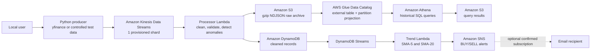

# Real-Time Stock Market Analytics Pipeline on AWS

## Complete Project and Interview Guide

**Project type:** Serverless, event-driven data engineering pipeline  
**AWS Region:** `us-east-1`  
**Environment:** `development`  
**Implementation:** Python, PowerShell, AWS CLI, AWS CloudFormation, SQL  
**Status:** Deployed and tested end to end  

---

## 1. Project summary

I designed and built a serverless real-time stock market analytics pipeline on AWS from the ground up. The system retrieves stock prices with Python and `yfinance`, sends the events into Amazon Kinesis Data Streams, processes and validates them with AWS Lambda, and stores the data in two different forms:

- raw, compressed history in Amazon S3 for long-term analytics;
- cleaned, structured records in Amazon DynamoDB for fast real-time access.

I made the S3 history queryable with AWS Glue Data Catalog and Amazon Athena. I also created a second event-driven Lambda function that reads changes from DynamoDB Streams, calculates SMA-5 and SMA-20 moving averages, detects BUY or SELL crossovers, and publishes the signal to Amazon SNS.

I provisioned the AWS infrastructure with modular CloudFormation templates instead of creating resources manually. I deliberately optimized the design for a learning/demo environment with low traffic and minimal cost.

### Thirty-second interview explanation

> I built a serverless stock analytics pipeline on AWS. A local Python producer fetches stock data using yfinance and publishes JSON events to a one-shard Kinesis stream. A Lambda consumer validates and enriches each record, archives compressed raw data in partitioned S3 folders, and stores cleaned data in DynamoDB. I created a Glue Catalog table with partition projection so Athena can query the S3 history without a paid Glue crawler. DynamoDB Streams invokes a second Lambda that calculates SMA-5 and SMA-20 crossover signals and publishes BUY or SELL alerts to SNS. I defined everything with CloudFormation, added least-privilege IAM policies, retention controls, automated tests, and cost limits.

---

## 2. Architecture



### End-to-end data flow

1. I start the Python producer on my local computer.
2. The producer retrieves a stock price from `yfinance` or generates controlled test data.
3. It serializes the event as JSON and sends it to Kinesis using the stock symbol as the partition key.
4. A Kinesis event source mapping invokes the processor Lambda.
5. The processor validates and normalizes the event and detects price or volume anomalies.
6. The original Kinesis record is compressed and archived in S3.
7. The cleaned record is written to DynamoDB.
8. DynamoDB Streams emits an `INSERT` record.
9. The trend Lambda queries the latest 21 prices for the symbol.
10. It calculates the previous and current SMA-5 and SMA-20 values.
11. If the moving averages cross, the function records the signal and publishes it to SNS.
12. Separately, Glue describes the raw S3 schema and Athena queries that history with SQL.

---

## 3. Why I selected these services

### Amazon Kinesis Data Streams

I used Kinesis because this is an ordered streaming workload rather than a simple task queue. Kinesis preserves records temporarily, supports multiple downstream consumers, and integrates directly with Lambda. I used the stock symbol as the partition key so records for the same symbol maintain order within the shard.

### AWS Lambda

Lambda is appropriate because both processing paths are event-driven and short-lived. I do not need to maintain an EC2 server, patch an operating system, or pay for idle compute. Both functions use ARM64 with 128 MB memory to minimize compute cost.

### Amazon S3 and DynamoDB together

I intentionally used both services because they solve different problems:

- S3 is the durable raw archive and historical data lake.
- DynamoDB supports millisecond key-based and time-range access for recent cleaned records.

This pattern gives me a low-cost source of truth in S3 and a fast operational data store in DynamoDB.

### AWS Glue Data Catalog and Amazon Athena

Glue provides the schema-on-read metadata Athena needs. Athena lets me run SQL directly against the S3 files without managing a database or analytics cluster.

I defined the schema directly in CloudFormation and enabled partition projection. I did not create a Glue crawler because a crawler would add DPU charges and is unnecessary when the schema and S3 folder format are already known.

### DynamoDB Streams and Amazon SNS

DynamoDB Streams provides an event-driven connection between new cleaned records and the trend Lambda. This avoids scheduled polling. SNS separates signal detection from notification delivery and can later support email, SMS, HTTPS webhooks, or other subscribers.

### AWS CloudFormation

I used CloudFormation so the project is repeatable, reviewable, and removable as a set of managed stacks. Cross-stack exports connect the Kinesis, storage, processing, analytics, and alert stacks without hardcoding resource ARNs into the application code.

---

## 4. Implementation steps

## Step 1 — Real-time ingestion with Kinesis

I created the `stock-market-kinesis` CloudFormation stack.

### Resource

- Stream name: `stock-market-analytics-stream-development`
- Mode: provisioned
- Shards: `1`
- Retention: `24` hours
- Encryption: AWS-managed Kinesis KMS key, `alias/aws/kinesis`
- Status verified: `ACTIVE`

### Why provisioned mode

The first version used on-demand capacity, but that was more expensive for a tiny demonstration workload. I replaced it with one provisioned shard, the smallest practical configuration. One shard is more than enough for this project and costs approximately `$0.015` per hour or `$0.36` per day in `us-east-1`.

### Files

- `cloudformation/01-kinesis-stream.yaml`
- `cloudformation/deploy-step1.ps1`
- `STEP1-README.md`

---

## Step 2 — Processing, cleaning, and anomaly detection

I created a processor Lambda and connected it to the Kinesis stream.

### Lambda configuration

- Function: `stock-market-analytics-processor-development`
- Runtime: Python 3.14
- Architecture: ARM64
- Memory: 128 MB
- Timeout: 10 seconds
- Batch size: up to 100 Kinesis records
- Maximum batching window: 1 second
- Parallelization factor: 1
- CloudWatch log retention: 1 day
- Provisioned concurrency: disabled

### Processing logic

For every event, the function:

1. Base64-decodes the Kinesis payload.
2. Parses the JSON document.
3. Converts the symbol to uppercase.
4. Validates the symbol format.
5. Validates that price and volume are finite numeric values.
6. Rejects zero or negative prices.
7. Normalizes timestamps to UTC ISO 8601 format.
8. Calculates the percentage change from `previous_close`.
9. Detects a price anomaly when the absolute change is at least 5%.
10. Detects a volume anomaly when volume is at least three times `average_volume`.
11. Returns partial batch failures so one invalid record does not force every successful record to be retried.

### Reliability configuration

- `ReportBatchItemFailures` is enabled.
- Failed batches can be bisected.
- Maximum retry attempts: 3.
- Maximum record age: 1 hour.

### Files

- `lambda/processor/index.py`
- `cloudformation/02-processing-lambda.yaml`
- `cloudformation/deploy-step2.ps1`
- `tests/test_processor.py`
- `STEP2-README.md`

---

## Step 3 — Raw and cleaned storage

I created the `stock-market-storage` stack and updated the processor Lambda with narrowly scoped permissions to write to S3 and DynamoDB.

### Raw S3 archive

- Bucket: `stock-market-analytics-raw-<account-id>-us-east-1`
- Public access: fully blocked
- Object ownership: bucket-owner enforced
- Encryption: SSE-S3/AES-256
- TLS: enforced through a bucket policy
- Versioning: disabled
- Lifecycle: raw demo data expires after 7 days
- Incomplete multipart uploads: aborted after 1 day

I store raw events as gzip-compressed newline-delimited JSON. The S3 object layout is:

```text
raw/year=YYYY/month=MM/day=DD/hour=HH/batch-<hash>.json.gz
```

I batch multiple records into one compressed object instead of writing one object per event. This reduces S3 request counts and storage.

### Raw record format

```json
{
  "sequence_number": "<kinesis-sequence-number>",
  "payload": {
    "symbol": "AAPL",
    "open": 342.1,
    "high": 345.0,
    "low": 340.5,
    "price": 343.83,
    "previous_close": 341.12,
    "volume": 1500000,
    "average_volume": 1000000,
    "timestamp": "2026-10-29T06:09:29Z",
    "source": "yfinance"
  }
}
```

### Cleaned DynamoDB table

- Table: `stock-market-analytics-cleaned-development`
- Table class: Standard
- Capacity: 1 RCU and 1 WCU, provisioned
- Partition key: `symbol`
- Sort key: `timestamp`
- Encryption: enabled
- Time to live attribute: `expires_at`
- TTL period: 7 days
- DynamoDB Streams: enabled with `NEW_AND_OLD_IMAGES`
- Point-in-time recovery: disabled for this demo

### Example cleaned item

```json
{
  "symbol": "AAPL",
  "timestamp": "2026-10-29T06:09:29.173651+00:00",
  "price": 343.83,
  "volume": 1500000,
  "previous_close": 341.12,
  "average_volume": 1000000,
  "price_change_pct": 0.7944,
  "is_anomaly": false,
  "anomaly_types": [],
  "source": "yfinance",
  "processed_at": "2026-10-29T06:09:30+00:00",
  "kinesis_sequence_number": "<kinesis-sequence-number>",
  "expires_at": 1793840000
}
```

### Files

- `cloudformation/03-storage.yaml`
- `cloudformation/deploy-step3.ps1`
- `STEP3-README.md`

---

## Step 4 — Historical analytics with Glue and Athena

I created the `stock-market-athena` stack.

### Glue resources

- Database: `stock_market_analytics_development`
- External table: `raw_stock_events`
- Serialization library: OpenX JSON SerDe
- Input format: Hadoop text input
- Compression: gzip
- Partition keys: `year`, `month`, `day`, `hour`

### Partition projection

I enabled partition projection with this location template:

```text
s3://stock-market-analytics-raw-<account-id>-us-east-1/
raw/year=${year}/month=${month}/day=${day}/hour=${hour}/
```

This means I do not need to run `MSCK REPAIR TABLE`, manually add each partition, or pay for a Glue crawler whenever a new hour appears.

### Athena workgroup

- Workgroup: `stock-market-analytics-development`
- Enforced output location: enabled
- Maximum data scanned per query: 10 MB
- CloudWatch workgroup metrics: disabled
- Encryption: SSE-S3

The 10 MB cutoff is the minimum Athena allows. It prevents an accidental broad query from scanning a large amount of data.

### Query-result storage

- Bucket: `stock-market-analytics-athena-<account-id>-us-east-1`
- Public access: blocked
- Encryption: SSE-S3
- TLS: required
- Lifecycle: results expire after 1 day
- Versioning: disabled

### Example Athena query

```sql
SELECT
    payload.symbol AS symbol,
    payload.price AS price,
    payload.volume AS volume,
    payload.timestamp AS event_timestamp,
    payload.source AS source
FROM raw_stock_events
WHERE year = '2026'
  AND month = '10'
  AND day = '29'
ORDER BY payload.timestamp DESC
LIMIT 50;
```

### Files

- `cloudformation/04-athena-analytics.yaml`
- `cloudformation/deploy-step4.ps1`
- `STEP4-README.md`

---

## Step 5 — Local live-data producer

I built a Python producer that runs on my computer instead of an always-on EC2 instance. This avoids a continuous compute charge.

### Producer capabilities

- Fetches current stock history using `yfinance`.
- Supports one or multiple ticker symbols.
- Uses the local AWS credential chain; no access keys are stored in the code.
- Sends each record to Kinesis with the symbol as the partition key.
- Defaults to one cycle every 60 seconds.
- Supports continuous mode or a fixed number of iterations.
- Provides mock mode for a safe ingestion test.
- Provides a controlled SMA crossover mode for an end-to-end alert test.
- Enforces a minimum one-second interval to protect the 1-WCU DynamoDB table.

### Dependencies

```text
boto3>=1.35,<2
yfinance>=0.2.54,<2
```

### Files

- `producer/stream_stock_data.py`
- `producer/requirements.txt`
- `tests/test_producer.py`
- `STEP5-README.md`

---

## Step 6 — Moving-average trend detection and SNS alerts

I created the `stock-market-alerts` stack.

### Trend Lambda

- Function: `stock-market-analytics-trend-development`
- Runtime: Python 3.14
- Architecture: ARM64
- Memory: 128 MB
- Timeout: 10 seconds
- Trigger: DynamoDB Streams
- Trigger filter: `INSERT` events only
- Batch size: 100
- Batching window: 30 seconds
- Retry attempts: 2
- Maximum record age: 1 hour
- Log retention: 1 day

### Signal algorithm

The function reads the latest 21 prices for each inserted symbol. Twenty-one values are necessary because I compare both the previous and current moving averages:

```text
previous SMA-5  = average of the last 5 prices before the newest record
previous SMA-20 = average of the last 20 prices before the newest record
current SMA-5   = average of the newest 5 prices
current SMA-20  = average of the newest 20 prices
```

A BUY signal is generated when:

```text
previous SMA-5 <= previous SMA-20
and
current SMA-5 > current SMA-20
```

A SELL signal is generated when:

```text
previous SMA-5 >= previous SMA-20
and
current SMA-5 < current SMA-20
```

### Duplicate-alert protection

Lambda stream integrations use at-least-once delivery, so a record can occasionally be processed more than once. Before publishing, my trend Lambda conditionally updates the newest DynamoDB item with:

- `alert_signal`
- `sma_5`
- `sma_20`
- `alerted_at`

The update uses `attribute_not_exists(alert_signal)`. If the same event is retried, the conditional update fails and the duplicate notification is skipped.

The event source mapping filters out `MODIFY` events, so the Lambda's own alert metadata update does not recursively trigger another analysis.

### SNS

- Topic: `stock-market-analytics-alerts-development`
- Type: Standard
- Published message: JSON containing symbol, signal, price, timestamp, SMA-5, SMA-20, and a summary
- Email subscription: optional CloudFormation parameter

The current deployment has no personal email endpoint configured. SNS publishing has been verified successfully. To receive an email, I can redeploy the stack with an address and confirm the AWS subscription email.

### Files

- `lambda/trend/index.py`
- `cloudformation/05-trend-alerts.yaml`
- `cloudformation/deploy-step6.ps1`
- `tests/test_trend.py`
- `STEP6-README.md`

---

## 5. Infrastructure inventory

### CloudFormation stacks

- `stock-market-kinesis`
  - Kinesis stream and stack exports
- `stock-market-storage`
  - Raw S3 bucket, DynamoDB table, lifecycle rules, and stack exports
- `stock-market-processor`
  - Processor Lambda, Kinesis trigger, log group, and IAM role
- `stock-market-athena`
  - Glue database/table, Athena workgroup/named query, and results bucket
- `stock-market-alerts`
  - Trend Lambda, DynamoDB Streams trigger, SNS topic, log group, and IAM role

### IAM roles

- `stock-market-analytics-processor-role-development`
  - Reads the specific Kinesis stream
  - Writes only to the project raw bucket
  - Writes only to the project DynamoDB table
  - Writes only to its CloudWatch log group
- `stock-market-analytics-trend-role-development`
  - Reads the specific DynamoDB stream
  - Queries and updates only the project table
  - Publishes only to the project SNS topic
  - Writes only to its CloudWatch log group

### CloudWatch log groups

- `/aws/lambda/stock-market-analytics-processor-development`
- `/aws/lambda/stock-market-analytics-trend-development`

Both retain logs for one day.

---

## 6. Security controls

I included the following controls:

- No AWS access keys or secrets are stored in the repository.
- The local producer uses the standard AWS credential provider chain.
- Kinesis is encrypted with the AWS-managed Kinesis key.
- DynamoDB server-side encryption is enabled.
- Both S3 buckets use server-side encryption.
- Both S3 buckets block all public access.
- Bucket ownership is enforced by the bucket owner.
- S3 bucket policies deny non-TLS requests.
- Lambda IAM permissions are resource-scoped instead of using broad administrator access.
- Raw data and cleaned demo data automatically expire.
- Athena workgroup settings override unsafe client-side result locations.
- Athena has a hard 10 MB per-query scan limit.
- No public API endpoint or inbound network port is required.

---

## 7. Cost controls and estimated cost

I designed this project to stay within a very small AWS budget.

### Ongoing cost

The one provisioned Kinesis shard is the main continuous charge:

```text
$0.015 per hour
$0.36 per 24-hour day
approximately $10.95 per 30-day month
```

Kinesis cannot be paused. I must delete its stack to stop the shard-hour charge.

### Services expected to remain free or nearly free at demo volume

- DynamoDB uses only 1 RCU and 1 WCU, within its 25/25 Free Tier allowance.
- Lambda uses 128 MB functions with very few invocations.
- DynamoDB Streams reads by Lambda do not add stream-read charges.
- Glue has only one database and one table and no crawler or ETL job.
- SNS has only a few publishes and no SMS endpoint.
- S3 stores only a few kilobytes and automatically deletes old objects.
- CloudWatch logs expire after one day.
- Athena runs only manual, partition-filtered queries.

### Athena cost

Athena bills at a minimum of 10 MB per query even when the actual file is smaller. At `$5` per TB, a minimum-size query is approximately `$0.00005`.

### Cost state observed during the build

AWS Cost Explorer still displayed approximately `$0.00` because same-day usage had not posted. Based on the stream creation time and the regional shard rate, the estimated accrued cost at the end of the build was approximately `$0.02–$0.03`.

---

## 8. Automated and live testing

## Local unit tests

I created nine tests covering the processor, producer, and trend logic.

```powershell
.\.venv\Scripts\python.exe -m unittest discover -s tests -v
```

Verified result:

```text
Ran 9 tests
OK
```

The tests cover:

- normalization and anomaly detection;
- invalid-record partial failure handling;
- normal processor records;
- producer record contract;
- Kinesis stream name and partition key behavior;
- BUY crossover detection;
- SELL crossover detection;
- insufficient trend history;
- DynamoDB stream filtering for inserts only.

## Producer-to-storage test

I sent a `DEMO` record through the real Kinesis stream.

Verified DynamoDB result:

```json
{
  "symbol": "DEMO",
  "timestamp": "2026-10-29T06:03:57.416193+00:00",
  "price": "205.5",
  "source": "mock-producer"
}
```

Verified raw S3 object:

```text
raw/year=2026/month=10/day=29/hour=06/
batch-<hash>.json.gz
```

## Athena test

I ran a live Athena query against the raw S3 archive.

- Query ID: `<athena-query-id>`
- State: `SUCCEEDED`
- Actual bytes scanned: `202`
- Billed minimum: 10 MB

Returned row:

```text
symbol: NVDA
price: 205.5
volume: 1500000
timestamp: 2026-10-29T05:12:00Z
source: step3-test
```

## Controlled full-pipeline crossover test

I sent 20 prices at `100` followed by one price at `110` for symbol `SMA1`.

Verified result:

```text
signal: BUY
price: 110
SMA-5: 102
SMA-20: 100.5
```

SNS publication evidence:

```text
event: trend_alert_published
message_id: <sns-message-id>
summary: SMA1 produced an upward SMA-5/SMA-20 crossover.
```

## Live yfinance test

I fetched one live AAPL record with `yfinance`, sent it through Kinesis, and verified it in DynamoDB.

```text
symbol: AAPL
price: 343.83
timestamp: 2026-10-29T06:09:29.173651+00:00
source: yfinance
```

---

## 9. How to rebuild the project from scratch

## Prerequisites

- Windows PowerShell
- Python 3
- AWS CLI v2
- AWS credentials configured locally
- Permission to create CloudFormation, Kinesis, Lambda, IAM, S3, DynamoDB, Glue, Athena, SNS, and CloudWatch resources

Verify identity:

```powershell
aws sts get-caller-identity --region us-east-1
```

## Install local Python dependencies

```powershell
cd C:\path\to\aws_4
python -m venv .venv
.\.venv\Scripts\python.exe -m pip install -r producer\requirements.txt
```

## Run tests

```powershell
.\.venv\Scripts\python.exe -m unittest discover -s tests -v
```

## Deploy the stacks

Run from the project root:

```powershell
.\cloudformation\deploy-step1.ps1
.\cloudformation\deploy-step3.ps1
.\cloudformation\deploy-step4.ps1
.\cloudformation\deploy-step6.ps1
```

Important deployment detail: `deploy-step3.ps1` creates the storage resources and then invokes `deploy-step2.ps1`, because the current processor template imports the S3 and DynamoDB stack outputs.

## Optional email subscription

```powershell
.\cloudformation\deploy-step6.ps1 -AlertEmail "<email-address>"
```

AWS sends a confirmation email. The recipient must click **Confirm subscription** before notifications can be delivered.

---

## 10. How to run and demonstrate the project

## Quick ingestion test

```powershell
cd C:\path\to\aws_4
.\.venv\Scripts\python.exe producer\stream_stock_data.py `
  --mock `
  --iterations 1 `
  --symbols DEMO
```

## Live stock mode

```powershell
.\.venv\Scripts\python.exe producer\stream_stock_data.py `
  --symbols AAPL,MSFT `
  --interval 60
```

Press `Ctrl+C` to stop the local producer.

## Guaranteed crossover demonstration

Use a new symbol each time because older records remain until TTL removes them:

```powershell
.\.venv\Scripts\python.exe producer\stream_stock_data.py `
  --test-crossover `
  --test-symbol SMA2 `
  --interval 1.1
```

Wait approximately 30–60 seconds for the DynamoDB batching window and Lambda processing.

Expected newest DynamoDB item:

```text
alert_signal = BUY
sma_5 = 102
sma_20 = 100.5
```

---

## 11. Where to demonstrate each component in the AWS Console

Always select `us-east-1`.

### Kinesis

Open **Amazon Kinesis → Data streams → `stock-market-analytics-stream-development`**.

Show:

- ACTIVE status;
- provisioned mode;
- one open shard;
- 24-hour retention;
- encryption.

### Processor Lambda

Open **AWS Lambda → `stock-market-analytics-processor-development`**.

Show:

- Kinesis trigger;
- ARM64 and 128 MB configuration;
- environment variables;
- IAM role;
- CloudWatch logs.

### S3

Open **Amazon S3 → `stock-market-analytics-raw-<account-id>-us-east-1`**.

Show the `raw/year=/month=/day=/hour=` partition folders and gzip objects.

### DynamoDB

Open **DynamoDB → Tables → `stock-market-analytics-cleaned-development` → Explore items**.

Show:

- composite primary key;
- cleaned stock fields;
- TTL;
- an item containing an alert signal;
- DynamoDB Streams configuration.

### Glue

Open **AWS Glue → Data Catalog → Databases → `stock_market_analytics_development` → `raw_stock_events`**.

Show the nested `payload` schema, partition keys, and partition projection properties.

### Athena

Open **Amazon Athena → Query editor**.

Select:

- Workgroup: `stock-market-analytics-development`
- Database: `stock_market_analytics_development`
- Table: `raw_stock_events`

Show the recent successful query and its data-scanned value.

### Trend Lambda and SNS

Open:

- **Lambda → `stock-market-analytics-trend-development`**
- **SNS → Topics → `stock-market-analytics-alerts-development`**
- **CloudWatch → `/aws/lambda/stock-market-analytics-trend-development`**

Show the DynamoDB trigger and the `trend_alert_published` log event.

---

## 12. Operational behavior and trade-offs

### Delivery guarantee

Kinesis and DynamoDB Streams integrations provide at-least-once processing, not exactly-once delivery. I handle this by:

- using deterministic S3 batch keys based on Kinesis sequence numbers;
- overwriting DynamoDB items using the same symbol/timestamp key;
- using a conditional update to prevent duplicate SNS alerts;
- returning partial failures for individual Kinesis records.

### Near real time, not exchange-grade real time

This is a near-real-time learning and portfolio project. It is not an exchange trading system. `yfinance` is suitable for demonstration data but may be delayed and is not a guaranteed institutional market feed.

### Data consistency

The processor writes to S3 and DynamoDB sequentially. This is sufficient for the demo, but it is not a distributed transaction. A production design could add an intermediate delivery service, retry queue, or reconciliation process.

### Scaling

The current design intentionally uses one shard and 1 RCU/1 WCU. For higher volume I would:

- increase Kinesis shards or use on-demand mode;
- use DynamoDB auto scaling or on-demand capacity;
- tune Lambda batch size and parallelization;
- write larger S3 files;
- convert JSON to Parquet;
- add dead-letter or failure destinations;
- add CloudWatch alarms for iterator age, throttles, and Lambda errors.

---

## 13. Problems I solved during implementation

### Keeping Kinesis affordable

Kinesis has no standard Free Tier. I compared the capacity modes and chose a single provisioned shard, reducing the predictable idle cost to approximately `$0.36` per day.

### Avoiding a paid Glue crawler

Because I controlled the JSON schema and folder layout, I defined the Glue table directly. Partition projection automatically maps SQL filters to S3 prefixes without storing thousands of partition objects.

### Preventing one bad record from retrying a complete batch

I enabled Lambda partial batch responses. The processor returns only the failed Kinesis sequence numbers in `batchItemFailures`.

### Avoiding duplicate alerts

I added a conditional DynamoDB update before considering a crossover claimed. This prevents an at-least-once retry from repeatedly publishing the same signal.

### Avoiding recursive DynamoDB triggers

The trend Lambda writes alert metadata back to the newest item. The event source filter accepts only `INSERT` events, so those `MODIFY` events are ignored.

### Testing a signal reliably

A real market crossover may not happen during a demonstration. I created a controlled mode that sends 20 prices at `100` and a final price at `110`, guaranteeing an upward SMA crossover while still testing the entire AWS path.

---

## 14. Interview questions and my answers

### Why did you use Kinesis instead of SQS?

Kinesis is designed for ordered streaming records, replay within a retention period, and multiple consumers. SQS is ideal for decoupled task processing, but it is not the same ordered stream and replay model. I also use the stock symbol as the partition key to keep each symbol's records ordered.

### Why store the same event in S3 and DynamoDB?

They serve different access patterns. S3 is a low-cost immutable history for analytics and reprocessing. DynamoDB provides fast operational lookups by symbol and time.

### How do you handle malformed input?

The processor validates types, finite numbers, symbol format, positive prices, and non-negative volumes. It reports only the failed record identifier so valid records in the batch can succeed.

### How do you avoid duplicate SNS alerts?

The trend Lambda conditionally adds `alert_signal` to the newest DynamoDB item only if that attribute does not already exist. A retry cannot claim the same alert twice.

### Why did you not use a Glue crawler?

The schema and folder pattern are controlled and stable. A directly defined catalog table plus partition projection is simpler, faster, and avoids crawler compute charges.

### How did you control Athena cost?

I compressed the source data, partitioned it by UTC year/month/day/hour, used partition projection, provided partition-filtered examples, expired query results after one day, and enforced Athena's minimum 10 MB per-query scan cutoff.

### What would you change for production?

I would use a licensed real-time market feed, use Parquet rather than NDJSON, add DLQs and alarms, enable stronger recovery controls, add CI/CD and infrastructure validation, use auto scaling, add schema versioning, add dashboards, and create a reconciliation process for the dual S3/DynamoDB writes.

### What was the most important engineering lesson?

The main lesson was that a real-time pipeline is more than connecting services. I had to think about ordering, retries, partial failure, idempotency, storage access patterns, query cost, retention, observability, and safe cleanup.

---

## 15. Honest limitations

I would explain these limitations openly in an interview:

- The local producer must be running for new events to arrive.
- `yfinance` is a demonstration source, not a guaranteed real-time trading feed.
- One Kinesis shard and 1 RCU/1 WCU are intentionally sized for demo traffic.
- Gzip JSON is inexpensive and readable but less efficient for analytics than Parquet.
- The S3 and DynamoDB writes are not one atomic transaction.
- CloudWatch retention is only one day to minimize cost.
- Point-in-time recovery is disabled for the demo table.
- The SNS topic is deployed and publishing is verified, but the current deployment has no personal email subscription.
- The project detects technical crossover signals; it does not provide financial advice or execute trades.

These are deliberate demo trade-offs rather than hidden failures.

---

## 16. Safe cleanup procedure

Before deleting the local project folder, copy this Markdown file somewhere safe so the project explanation is preserved.

### Step 1 — Stop the local producer

Press `Ctrl+C` in the producer terminal. Confirm no producer process is still running.

### Step 2 — Empty the two S3 buckets

CloudFormation cannot delete a non-empty S3 bucket. The following commands permanently delete the project objects. Verify the account ID and bucket names before running them.

```powershell
$AccountId = aws sts get-caller-identity --query Account --output text

aws s3 rm `
  "s3://stock-market-analytics-athena-${AccountId}-us-east-1" `
  --recursive `
  --region us-east-1

aws s3 rm `
  "s3://stock-market-analytics-raw-${AccountId}-us-east-1" `
  --recursive `
  --region us-east-1
```

### Step 3 — Delete CloudFormation stacks in dependency order

```powershell
aws cloudformation delete-stack `
  --stack-name stock-market-alerts `
  --region us-east-1

aws cloudformation wait stack-delete-complete `
  --stack-name stock-market-alerts `
  --region us-east-1

aws cloudformation delete-stack `
  --stack-name stock-market-athena `
  --region us-east-1

aws cloudformation wait stack-delete-complete `
  --stack-name stock-market-athena `
  --region us-east-1

aws cloudformation delete-stack `
  --stack-name stock-market-processor `
  --region us-east-1

aws cloudformation wait stack-delete-complete `
  --stack-name stock-market-processor `
  --region us-east-1

aws cloudformation delete-stack `
  --stack-name stock-market-storage `
  --region us-east-1

aws cloudformation wait stack-delete-complete `
  --stack-name stock-market-storage `
  --region us-east-1

aws cloudformation delete-stack `
  --stack-name stock-market-kinesis `
  --region us-east-1

aws cloudformation wait stack-delete-complete `
  --stack-name stock-market-kinesis `
  --region us-east-1
```

This order matters because the downstream stacks import outputs from the upstream stacks.

### Step 4 — Confirm cleanup

Check:

- CloudFormation has no project stacks.
- Kinesis has no `stock-market-analytics-stream-development` stream.
- Lambda has no project functions.
- DynamoDB has no project table.
- S3 has no project buckets.
- Glue has no project database.
- Athena has no project workgroup.
- SNS has no project topic or pending subscription.
- IAM has no project roles.
- CloudWatch has no project log groups.

Deleting the Kinesis stack is the important step that stops the `$0.015` hourly shard charge.

---

## 17. Project file structure

```text
aws_4/
├── README.md
├── PROJECT-INTERVIEW-GUIDE.md
├── STEP1-README.md
├── STEP2-README.md
├── STEP3-README.md
├── STEP4-README.md
├── STEP5-README.md
├── STEP6-README.md
├── cloudformation/
│   ├── 01-kinesis-stream.yaml
│   ├── 02-processing-lambda.yaml
│   ├── 03-storage.yaml
│   ├── 04-athena-analytics.yaml
│   ├── 05-trend-alerts.yaml
│   ├── deploy-step1.ps1
│   ├── deploy-step2.ps1
│   ├── deploy-step3.ps1
│   ├── deploy-step4.ps1
│   └── deploy-step6.ps1
├── lambda/
│   ├── processor/
│   │   └── index.py
│   └── trend/
│       └── index.py
├── producer/
│   ├── requirements.txt
│   └── stream_stock_data.py
└── tests/
    ├── test_processor.py
    ├── test_producer.py
    └── test_trend.py
```

---

## 18. Resume-ready project description

### Short version

> Built a serverless real-time stock analytics pipeline on AWS using Python, Kinesis, Lambda, S3, DynamoDB, Glue, Athena, DynamoDB Streams, SNS, IAM, and CloudFormation. Implemented validation, anomaly detection, gzip raw archiving, partition-projected SQL analytics, SMA-5/SMA-20 crossover alerts, idempotent notification handling, automated tests, least-privilege access, and lifecycle-based cost controls.

### Bullet version

- Designed and deployed an event-driven stock-data pipeline with Amazon Kinesis and two ARM64 AWS Lambda functions.
- Implemented Python validation, UTC normalization, price/volume anomaly detection, partial batch failure reporting, and idempotent trend alerts.
- Archived gzip NDJSON events to partitioned S3 storage and served cleaned records from a composite-key DynamoDB table.
- Created a Glue external table with partition projection and an Athena workgroup with an enforced 10 MB scan limit.
- Calculated SMA-5/SMA-20 BUY and SELL crossover signals from DynamoDB Streams and published alerts through Amazon SNS.
- Provisioned modular AWS infrastructure using CloudFormation with least-privilege IAM, encryption, TTL, lifecycle expiration, automated tests, and low-cost capacity settings.

---

## 19. Final project outcome

I completed and verified the full architecture:

```text
Python/yfinance producer
    → Kinesis
    → processing Lambda
    → raw S3 + cleaned DynamoDB
    → Glue + Athena historical analytics
    → DynamoDB Streams
    → SMA trend Lambda
    → SNS alert publication
```

The project demonstrates practical skills in cloud architecture, streaming systems, serverless computing, data engineering, NoSQL design, analytics, infrastructure as code, security, testing, observability, idempotency, and cost optimization.

